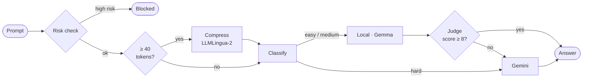

<div align="center">

# TokenWise

**Prompt optimization and model routing for LLM apps.**<br>
Trim prompts, send easy requests to a free local model and hard ones to Gemini,<br>
and check cheap answers before they reach the user.

[](https://github.com/inslot2525-ctrl/Tokeniser/actions/workflows/ci.yml)


[How it works](#how-it-works) · [Quick start](#quick-start) · [API](#api) · [Evaluation](#evaluation) · [Limitations](#limitations)


</div>

## Features

- **Routing by difficulty.** A rule-based classifier sends simple prompts to a local Gemma model (free) and hard ones to Gemini 2.5 Flash. It explains every decision and costs zero LLM calls.
- **Verify, then escalate.** A Gemini judge scores local answers 0–10, and weak ones are re-answered on Gemini, so you only pay for the remote model when it's needed.
- **Local prompt compression.** [LLMLingua-2](https://github.com/microsoft/LLMLingua), a small on-device model, removes **~42% of tokens** from typical prompts while spending **zero API tokens**. It keeps code blocks, numbers and constraint words ("not", "exactly", "must") intact. If it isn't installed, a single LLM rewrite call takes over.
- **Net token accounting.** Every response reports the tokens the pipeline itself spent, not just how much shorter the prompt got.
- **Jailbreak screening.** Catches common jailbreak, injection and data-exfiltration phrasings, even with odd spacing or leetspeak, and blocks high-risk prompts before any model call.
- **Built for real traffic.** Rate limiting, optional API key, input caps, timeouts, Ollama → Gemini fallback, SQLite metrics, tests, CI and Docker.

## How it works



A full `/agent` request makes **1 to 3** LLM calls: the answer, plus a judge call and a possible Gemini retry for local answers. The risk check, planner, compressor and classifier all run locally.


### Why local compression

The first version of this project optimized prompts by asking an LLM to rewrite them. That rewrite call costs the instructions, the prompt going in and the rewrite coming out, so **for a prompt sent once it consistently cost more tokens than it saved**. Every response reports the pipeline's own spend, so you can see this directly:

```json
"tokens": { "original": 96, "optimized": 41, "saved": 55, "pipeline_overhead": 228, "net_saved": -173 }
```

LLMLingua-2 fixes this: it runs on the server's CPU, so `pipeline_overhead` for compression is 0 and every saved token is a net saving. The trade-off is that it is *extractive*. It deletes words instead of rephrasing, so its output reads like notes (`"list exactly four advantages Docker containers deployment. don't mention Kubernetes"`). LLMs handle that well, but it is a reason to measure answer quality, not just token counts (see [Evaluation](#evaluation)).

## Quick start

You need Python 3.11+, Node 20+ and a [Gemini API key](https://aistudio.google.com). [Ollama](https://ollama.com) is optional; without it, everything routes to Gemini.

```bash
git clone https://github.com/inslot2525-ctrl/Tokeniser.git && cd Tokeniser
ollama pull gemma3:4b                     # optional local model
```

**Backend** (terminal 1)

```bash
cd backend
python -m venv .venv
source .venv/bin/activate                 # Windows: .venv\Scripts\activate
pip install -r requirements-dev.txt
pip install -r requirements-lingua.txt    # optional: local compression (PyTorch, ~1 GB)
cp .env.example .env                      # add your GEMINI_API_KEY
uvicorn app.main:app --reload             # http://127.0.0.1:8000
```

The compression model (~700 MB) downloads on first start.

**Frontend** (terminal 2)

```bash
cd frontend
cp .env.example .env
npm ci && npm run dev                     # http://localhost:5173
```

<details>
<summary><b>Run with Docker</b></summary>

```bash
docker build -t tokenwise-backend backend                                # LLM-rewrite only, small image
docker build -t tokenwise-backend --build-arg WITH_LINGUA=true backend   # bundles LLMLingua-2
docker run -p 8000:8000 --env-file backend/.env tokenwise-backend
```

The LLMLingua-2 image needs about 1.5 GB of RAM. On small hosts (e.g. Render's free tier), build without it and the optimizer uses the LLM rewrite.
</details>

<details>
<summary><b>Chrome extension</b></summary>

Open `chrome://extensions`, enable **Developer mode**, click **Load unpacked** and select `extension/`. If your backend isn't on `127.0.0.1:8000`, edit `API_BASE` at the top of `popup.js`.
</details>

**Tests** run offline with a fake model, so no API key is needed. The one test that loads the real compression model is skipped unless `llmlingua` is installed.

```bash
cd backend && pytest
```

## API

Every `POST` takes `{ "prompt": "..." }`. Endpoints that call a model are rate limited per IP, and require an `X-API-Key` header when `API_KEY` is set.

| Endpoint | What it does | Calls a model |
|---|---|:---:|
| `POST /agent` | Full pipeline: risk check → plan → rewrite → route → verify | ✓ |
| `POST /smart-optimize` | Fix grammar and compress; returns token metrics | ✓ |
| `POST /optimize` · `/compress` | Aggressive compression; returns token metrics | ✓ |
| `POST /enhance` | Grammar and clarity only | ✓ |
| `POST /route` | Classify, route and answer | ✓ |
| `POST /tokenize` | Token count | |
| `POST /detect-risk` | Jailbreak / injection / exfiltration check | |
| `GET /dashboard` | Request count, gross and net savings, route mix, cost | |
| `GET /health` | Liveness | |

<details>
<summary><b>Example <code>/agent</code> response</b></summary>

```json
{
  "processed_prompt": "Explain the difference between a process and a thread, simply.",
  "planner_reason": "Prompt is 71 tokens; worth one rewrite pass to trim it.",
  "steps": [
    "Prompt rewritten on Local",
    "Answered by gemma3:4b (Local)",
    "Verifier scored local answer 8.5/10"
  ],
  "route": "Local",
  "model": "gemma3:4b",
  "confidence": 85,
  "estimated_remote_cost": "$0.000210",
  "verification": { "score": 8.5, "reason": "Accurate and clear." },
  "risk": { "risk": "LOW", "attack_type": "None", "confidence": 5, "matched_patterns": [] },
  "analysis": { "category": "General", "difficulty": "Easy", "signals": ["short, simple request"] },
  "tokens": { "original": 71, "optimized": 14, "saved": 57, "pipeline_overhead": 412, "net_saved": -355 },
  "response": "..."
}
```

Illustrative values. The cost covers the Gemini judge call; the local calls are free.
</details>

## Evaluation

[`backend/eval/run_eval.py`](backend/eval/run_eval.py) runs 20 prompts (verbose, concise, constraint-heavy and hard) through the optimizer.

### Results: LLMLingua-2 compression

Measured on CPU, `COMPRESSION_RATE=0.6`. Full table and sample outputs: [`eval/results-lingua.md`](backend/eval/results-lingua.md).

| | |
|---|---|
| Token reduction, prompts ≥ 40 tokens | **41.6%** (419 of 1,008 tokens) |
| Token reduction, all 20 prompts | 31.4% mean · 39.7% median |
| API tokens spent on compression | **0** |
| Net savings on a single use | **+419 tokens** (break-even on first use) |
| Latency | ~0.54 s per prompt (median, CPU) |
| Short prompts (< 40 tokens) | Left unchanged by design |

Sample (constraint words and numbers are preserved):

```
Before: I would like you to list exactly four advantages of using Docker containers for deployment. Please number them
        1 to 4, keep each one to a single sentence, and please don't mention Kubernetes at all in your answer because
        my audience doesn't know what it is.
After:  list exactly four advantages Docker containers deployment. number 1 to 4, keep each single sentence, don't
        mention Kubernetes answer audience doesn't know.
```

> [!IMPORTANT]
> These numbers measure **token reduction**, not **answer quality**. The `--quality` mode checks quality by answering both versions of each prompt with Gemini and having a blind judge compare the answers. It has not been run yet, so it's still an open question whether the compressed prompts get equally good answers.

### Running it

```bash
cd backend
python -m eval.run_eval --compressor lingua --out eval/results-lingua.md   # no API key needed
python -m eval.run_eval --compressor llm                                    # LLM rewrite, for comparison
python -m eval.run_eval --compressor lingua --quality                       # + answer quality (needs GEMINI_API_KEY)
```

Each run reports token reduction, the optimizer's own API-token overhead, net savings, the break-even reuse count and latency.

## Configuration

All settings are environment variables; see [`backend/.env.example`](backend/.env.example).

<details>
<summary><b>All variables</b></summary>

| Variable | Default | Purpose |
|---|---|---|
| `GEMINI_API_KEY` | — | Remote route, verifier and fallback |
| `GEMINI_MODEL` | `gemini-2.5-flash` | Remote model |
| `MODEL_PROVIDER` | `auto` | `auto` (router decides), `gemini` or `ollama` |
| `OLLAMA_URL` · `OLLAMA_MODEL` | `localhost:11434` · `gemma3:4b` | Local model |
| `CORS_ORIGINS` | `http://localhost:5173` | Comma-separated allowed origins |
| `API_KEY` | *(off)* | Require `X-API-Key` on model endpoints |
| `RATE_LIMIT_PER_MINUTE` | `20` | Per-IP limit on model endpoints |
| `MAX_PROMPT_CHARS` | `8000` | Reject longer prompts |
| `LLM_TIMEOUT_SECONDS` | `60` | Per-call timeout |
| `VERIFY_THRESHOLD` | `8` | Local answers below this are escalated |
| `REMOTE_INPUT_PRICE_PER_M` · `REMOTE_OUTPUT_PRICE_PER_M` | `0.30` · `2.50` | USD per 1M tokens |
| `METRICS_DB_PATH` | `metrics.db` | SQLite file for the dashboard |
| `COMPRESSOR` | `auto` | `auto` (LLMLingua-2 if installed, else LLM rewrite) or `llm` |
| `COMPRESSION_RATE` | `0.6` | Fraction of tokens LLMLingua-2 keeps |
</details>

## Project structure

<details>
<summary><b>Show tree</b></summary>

```
backend/
  app/
    main.py               FastAPI app, CORS, error handling
    config.py             Settings from env
    api/                  Routes, API key + rate limiter
    engine/
      agent.py            Pipeline orchestration + token accounting
      llm.py              Gemini / Ollama clients with fallback
      compressor.py       Local LLMLingua-2 compression
      optimizer.py        Compression, or LLM rewrite as a fallback
      planner.py          Decides whether a rewrite pays off
      complexity.py       Rule-based difficulty classifier
      router.py           Backend choice + cost
      verifier.py         LLM judge for local answers
      jailbreak_detector.py
    analytics/metrics.py  SQLite request log
  tests/                  pytest, fake model, no network
  eval/                   Prompt set + evaluation script
frontend/                 React 19 · TypeScript · Vite · Tailwind v4 · Recharts
extension/                Chrome extension (Manifest V3)
```
</details>

## Limitations

- **Pattern-based risk check.** It stops low-effort attacks for free; paraphrased ones will get through. Production use needs a trained classifier or a moderation API.
- **Heuristic routing.** It's explainable and free but will misroute some prompts, and the verifier loop is the safety net. A natural next step is training a small classifier on logged routes and judge scores.
- **Per-process rate limit.** Multiple workers or instances would need a shared store such as Redis.
- **Compression quality is unmeasured.** Token savings are measured, but whether compressed prompts get equally good answers is not yet (see [Evaluation](#evaluation)). Extractive compression can drop context a model needed.
- **Compression needs memory.** LLMLingua-2 needs ~1.5 GB of RAM and adds ~0.5 s per prompt on CPU, so it doesn't fit free-tier hosting.
- **LLM-judge bias.** Judges favour longer answers and their own model family, so scores are a signal, not ground truth.
- **Approximate token counts.** Counts use tiktoken `o200k_base`; Gemini and Gemma tokenize differently. Costs use the usage each API actually reports.

## License

[MIT](LICENSE)
