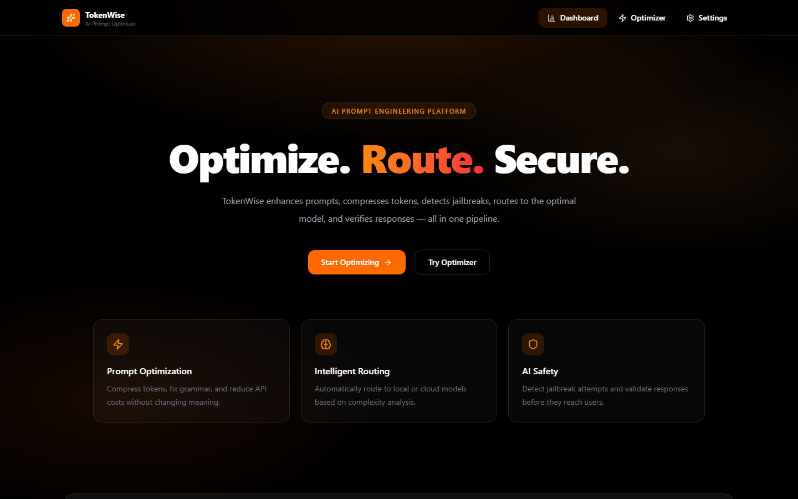
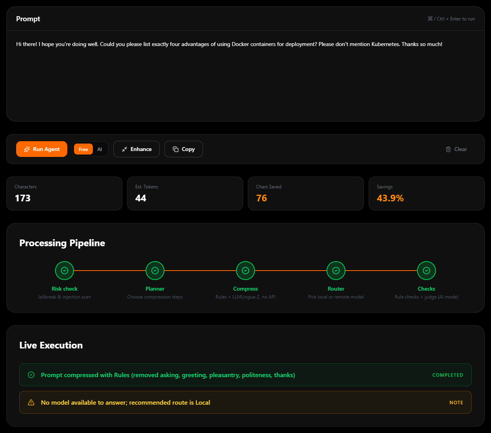
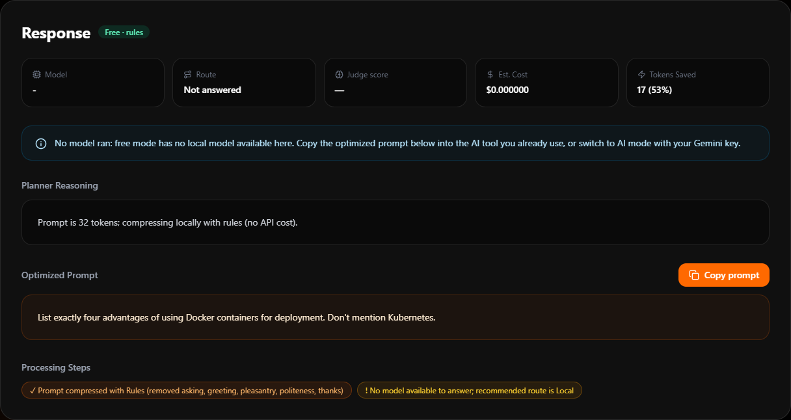
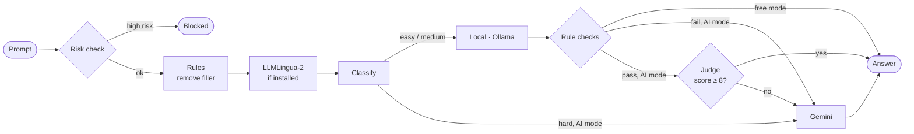

<div align="center">

# TokenWise

**Cut prompt tokens for free, route each prompt to the right model, and check answers before they reach the user.**<br>
Works without an API key. Add your own Gemini key when you want more.

[](https://github.com/inslot2525-ctrl/Tokeniser/actions/workflows/ci.yml)


[Modes](#two-modes) · [How it works](#how-it-works) · [Quick start](#quick-start) · [API](#api) · [Evaluation](#evaluation) · [Limitations](#limitations)



</div>

## Features

- **Free and AI modes.** Free mode runs on rules and local models and never calls a paid API. AI mode uses Gemini with **the user's own key**, so the app owner pays nothing and has no shared key to leak.
- **Compression that costs zero API tokens.** Rule-based filler removal, then [LLMLingua-2](https://github.com/microsoft/LLMLingua) on-device, cuts **44% of prompt tokens** on the eval set. Code, numbers and constraint words ("not", "exactly", "must") are kept intact.
- **Rule-based answer checks.** Every answer is checked for refusals, truncation, missing code, wrong item counts ("exactly four" answered with five) and words the prompt ruled out ("don't mention Kubernetes"). In AI mode, a local answer that fails a check goes straight to Gemini, with no judge call needed.
- **Routing by difficulty.** A transparent classifier sends easy prompts to a local Gemma model and hard ones to Gemini, and explains each decision.
- **Net token accounting.** Every response reports what the pipeline itself spent, so savings are net savings.
- **Jailbreak screening.** Common jailbreak, injection and exfiltration phrasings are blocked before any model call, even with odd spacing or leetspeak.
- **Built for real traffic.** Rate limiting, input caps, timeouts, clear errors (400 / 401 / 503), SQLite metrics, 61 tests, CI and Docker.

## Two modes

| | **Free** (default) | **AI** (your Gemini key) |
|---|---|---|
| Compression | Rules + LLMLingua-2 if installed | Same (local, 0 API tokens) |
| Risk check, routing, token and cost estimates | ✓ | ✓ |
| Answers | Ollama, when it's running | Ollama for easy prompts, Gemini for hard ones |
| Answer checks | Rules | Rules **+** Gemini judge, with escalation |
| With no model available | Returns the optimized prompt to paste into any AI tool | Falls back to Gemini |
| Cost to the app owner | Nothing | Nothing (users pay with their own key) |

In AI mode the key is entered in Settings, kept in the browser (session storage unless the user opts in to remembering it), and sent only to this app's backend in an `X-Gemini-Key` header. The backend uses it for that one request and never stores or logs it.

<table>
<tr>
<td width="50%"></td>
<td width="50%"></td>
</tr>
<tr>
<td align="center"><sub>Free/AI toggle and the pipeline after a run</sub></td>
<td align="center"><sub>Free mode with no model: the optimized prompt is the result</sub></td>
</tr>
</table>

## How it works



The risk check, compressor, classifier and answer checks are all local code. A full `/agent` request makes **0 to 3** LLM calls:
- 0 in free mode without Ollama,
- 1 for an answer,
- up to 3 in AI mode: a local answer, the judge, and a Gemini retry.

### Why compression is local

The first version optimized prompts by asking an LLM to rewrite them. That rewrite costs the instructions, the prompt going in and the rewrite coming out, so **for a prompt sent once it cost more tokens than it saved**. The response's token accounting shows it directly:

```json
"tokens": { "original": 96, "optimized": 41, "saved": 55, "pipeline_overhead": 228, "net_saved": -173 }
```

Local compression fixes this. `pipeline_overhead` for compression is 0, so every saved token is a net saving. The LLM rewrite is still available with `COMPRESSOR=llm`, for comparison.

## Quick start

You need Python 3.11+ and Node 20+. **No API key is needed**: free mode works out of the box. Optionally install [Ollama](https://ollama.com) to get answers in free mode, and get a [Gemini key](https://aistudio.google.com/app/apikey) for AI mode.

```bash
git clone https://github.com/inslot2525-ctrl/Tokeniser.git && cd Tokeniser
ollama pull gemma3:4b                     # optional: local answers
```

**Backend** (terminal 1)

```bash
cd backend
python -m venv .venv
source .venv/bin/activate                 # Windows: .venv\Scripts\activate
pip install -r requirements-dev.txt
pip install -r requirements-lingua.txt    # optional: LLMLingua-2 (PyTorch, ~1 GB; model downloads on first start)
cp .env.example .env
uvicorn app.main:app --reload             # http://127.0.0.1:8000
```

**Frontend** (terminal 2)

```bash
cd frontend
cp .env.example .env
npm ci && npm run dev                     # http://localhost:5173
```

**Tests** run offline with a fake model, so no key is needed:

```bash
cd backend && pytest                      # 61 tests
```

<details>
<summary><b>Deploying (e.g. Render + Vercel)</b></summary>

- **Don't set `GEMINI_API_KEY`** on a public backend. Users bring their own key, so there's no shared quota to drain.
- Set `CORS_ORIGINS` to your frontend's URL, and `VITE_API_URL` on the frontend to your backend's URL.
- Small hosts (Render's free tier has 512 MB) can't run LLMLingua-2. Use the default image, which compresses with rules alone.

```bash
docker build -t tokenwise-backend backend                                # rules only, small image
docker build -t tokenwise-backend --build-arg WITH_LINGUA=true backend   # + LLMLingua-2 (~1.5 GB RAM)
docker run -p 8000:8000 --env-file backend/.env tokenwise-backend
```
</details>

<details>
<summary><b>Chrome extension</b></summary>

Open `chrome://extensions`, enable **Developer mode**, click **Load unpacked** and select `extension/`. If your backend isn't on `127.0.0.1:8000`, edit `API_BASE` at the top of `popup.js`.
</details>

## API

`POST` bodies are `{ "prompt": "...", "mode": "free" | "ai" }`, with `mode` defaulting to `free`. AI mode reads the key from the `X-Gemini-Key` header. Endpoints that can call a model are rate limited per IP.

| Endpoint | What it does |
|---|---|
| `POST /agent` | Full pipeline: risk check → compress → route → answer → checks |
| `POST /smart-optimize` · `/optimize` · `/compress` | Local compression, with token metrics and the phrases removed |
| `POST /enhance` | Grammar and clarity (needs a model: Ollama or AI mode) |
| `POST /route` | Classify, route and answer |
| `POST /tokenize` | Token count |
| `POST /detect-risk` | Jailbreak / injection / exfiltration check |
| `GET /dashboard` | Request count, gross and net savings, route mix, cost |
| `GET /health` | Liveness |

| Status | Meaning |
|---|---|
| `400` | AI mode without a key |
| `401` | Gemini rejected the key |
| `503` | No model available (e.g. `/enhance` in free mode without Ollama); the message says how to fix it |
| `429` | Rate limit |

<details>
<summary><b>Example <code>/agent</code> response (free mode, no local model)</b></summary>

A real response from the backend with no key and no Ollama:

```json
{
  "mode": "free",
  "original_prompt": "Hi there! I hope you're doing well. Could you please list exactly four advantages of using Docker containers for deployment? Please don't mention Kubernetes. Thanks so much!",
  "processed_prompt": "List exactly four advantages of using Docker containers for deployment. Don't mention Kubernetes.",
  "planner_reason": "Prompt is 32 tokens; compressing locally with rules (no API cost).",
  "steps": [
    "Prompt compressed with Rules (removed asking, greeting, pleasantry, politeness, thanks)",
    "No model available to answer; recommended route is Local"
  ],
  "route": "Not answered",
  "model": "-",
  "confidence": null,
  "estimated_remote_cost": "$0.000000",
  "verification": null,
  "checks": null,
  "response": null,
  "risk": { "risk": "LOW", "attack_type": "None", "confidence": 5, "matched_patterns": [] },
  "analysis": {
    "category": "General", "difficulty": "Easy", "reasoning": "Low", "recommended_route": "Local",
    "signals": ["short, simple request"], "estimated_input_tokens": 15, "estimated_output_tokens": 150
  },
  "tokens": { "original": 32, "optimized": 15, "saved": 17, "pipeline_overhead": 0, "net_saved": 17 }
}
```
</details>

## Evaluation

[`backend/eval/run_eval.py`](backend/eval/run_eval.py) runs 20 prompts (verbose, concise, constraint-heavy and hard) through the compressor. No API key is needed for token metrics.

### Results

| Method | Tokens saved | API tokens spent | Latency (median, CPU) | Runs on a 512 MB host |
|---|---|---|---|:---:|
| Rules | **15.1%** (161 of 1,065) | 0 | < 1 ms | ✓ |
| Rules + LLMLingua-2 | **44.4%** (473 of 1,065) | 0 | ~0.3 s | ✗ |

On prompts of 40+ tokens, rules + LLMLingua-2 saves 46.9%. Short prompts are left to the rules alone, because the model tends to drop the instruction verb ("Summarize the theory of evolution…" became "evolution three sentences"). Prompts containing unfenced code skip LLMLingua-2 entirely, because it mangled `i <= arr.length; i++`. Full tables and samples: [`results-rules.md`](backend/eval/results-rules.md), [`results-lingua.md`](backend/eval/results-lingua.md).

```
Original:  I would like you to list exactly four advantages of using Docker containers for deployment. Please number
           them 1 to 4, keep each one to a single sentence, and please don't mention Kubernetes at all in your answer
           because my audience doesn't know what it is.

Rules:     List exactly four advantages of using Docker containers for deployment. Number them 1 to 4, keep each one to
           a single sentence, and don't mention Kubernetes at all in your answer because my audience doesn't know what it is.

+ LLMLingua-2:  exactly four advantages Docker containers deployment. Number 1 to 4, each single sentence, don't mention
                Kubernetes audience doesn't know.
```

Rules keep the prompt readable; LLMLingua-2 trades readability for size. Both keep every constraint.

> [!IMPORTANT]
> These numbers measure **token reduction**, not **answer quality**. `--quality` answers both versions of each prompt with Gemini and has a blind judge compare them. It hasn't been run yet, so whether compressed prompts get equally good answers is still open.

```bash
cd backend
python -m eval.run_eval --compressor rules  --out eval/results-rules.md    # no key needed
python -m eval.run_eval --compressor lingua --out eval/results-lingua.md   # rules + LLMLingua-2, no key needed
python -m eval.run_eval --compressor lingua --quality                      # + answer quality (needs GEMINI_API_KEY)
```

## Configuration

All settings are environment variables; see [`backend/.env.example`](backend/.env.example).

<details>
<summary><b>All variables</b></summary>

| Variable | Default | Purpose |
|---|---|---|
| `GEMINI_API_KEY` | *(unset)* | Fallback key for AI mode when self-hosting. Leave unset on public deploys |
| `GEMINI_MODEL` | `gemini-2.5-flash` | Remote model |
| `MODEL_PROVIDER` | `auto` | `auto` (router decides), `gemini` or `ollama` |
| `OLLAMA_URL` · `OLLAMA_MODEL` | `localhost:11434` · `gemma3:4b` | Local model |
| `COMPRESSOR` | `auto` | `auto` (rules + LLMLingua-2 if installed), `rules`, or `llm` (paid rewrite) |
| `COMPRESSION_RATE` | `0.6` | Fraction of tokens LLMLingua-2 keeps |
| `CORS_ORIGINS` | `http://localhost:5173` | Comma-separated allowed origins |
| `API_KEY` | *(off)* | Require `X-API-Key` on model endpoints |
| `RATE_LIMIT_PER_MINUTE` | `20` | Per-IP limit on model endpoints |
| `MAX_PROMPT_CHARS` | `8000` | Reject longer prompts |
| `LLM_TIMEOUT_SECONDS` | `60` | Per-call timeout |
| `VERIFY_THRESHOLD` | `8` | AI mode: local answers the judge scores below this are escalated |
| `REMOTE_INPUT_PRICE_PER_M` · `REMOTE_OUTPUT_PRICE_PER_M` | `0.30` · `2.50` | USD per 1M tokens |
| `METRICS_DB_PATH` | `metrics.db` | SQLite file for the dashboard |
</details>

## Project structure

<details>
<summary><b>Show tree</b></summary>

```
backend/
  app/
    main.py               FastAPI app, CORS, error handling
    config.py             Settings from env
    api/                  Routes (mode + per-request key), API key, rate limiter
    engine/
      agent.py            Pipeline orchestration + token accounting
      llm.py              Gemini / Ollama clients, per-request key scope
      rule_compressor.py  Rule-based filler removal
      compressor.py       LLMLingua-2 compression
      optimizer.py        Compression chain (rules -> LLMLingua-2), or LLM rewrite
      answer_checks.py    Rule-based answer checks
      complexity.py       Rule-based difficulty classifier
      router.py           Backend choice + cost
      verifier.py         LLM judge (AI mode)
      jailbreak_detector.py
    analytics/metrics.py  SQLite request log
  tests/                  pytest, fake model, no network
  eval/                   Prompt set, evaluation script, results
frontend/                 React 19 · TypeScript · Vite · Tailwind v4 · Recharts
extension/                Chrome extension (Manifest V3)
```
</details>

## Limitations

- **Answer quality after compression is unmeasured.** Token savings are measured; whether compressed prompts get equally good answers isn't yet (see [Evaluation](#evaluation)).
- **Rules catch visible failures, not wrong answers.** The answer checks find refusals, truncation and broken constraints. Judging correctness needs a model, which is why AI mode adds the judge.
- **Rule compression only knows its list.** It removes common English filler and nothing else, which is safe but limits the savings to 15%.
- **Pattern-based risk check.** It stops low-effort attacks for free; paraphrased ones will get through. Production use needs a trained classifier or a moderation API.
- **Heuristic routing.** It's explainable and free but will misroute some prompts. A natural next step is training a small classifier on logged routes and check results.
- **Per-process rate limit.** Multiple workers or instances would need a shared store such as Redis.
- **Approximate token counts.** Counts use tiktoken `o200k_base`; Gemini and Gemma tokenize differently. Costs use the usage each API reports.

## License

[MIT](LICENSE)
