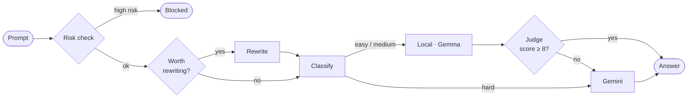

<div align="center">

# TokenWise

**Prompt optimization and model routing for LLM apps.**<br>
Trim prompts, send easy requests to a free local model and hard ones to Gemini,<br>
and check cheap answers before they reach the user.

[](https://github.com/inslot2525-ctrl/Tokeniser/actions/workflows/ci.yml)


[How it works](#how-it-works) · [Quick start](#quick-start) · [API](#api) · [Evaluation](#evaluation) · [Limitations](#limitations)


</div>

## Features

- **Routing by difficulty.** A rule-based classifier sends simple prompts to a local Gemma model (free) and hard ones to Gemini 2.5 Flash. It explains every decision and costs zero LLM calls.
- **Verify, then escalate.** A Gemini judge scores local answers 0–10, and weak ones are re-answered on Gemini, so you only pay for the remote model when it's needed.
- **One-pass prompt rewriting.** Fixes grammar and strips filler in a single call. It's skipped for short prompts, where the rewrite would cost more than it saves.
- **Net token accounting.** Every response reports the tokens the pipeline itself spent, not just how much shorter the prompt got.
- **Jailbreak screening.** Catches common jailbreak, injection and data-exfiltration phrasings, even with odd spacing or leetspeak, and blocks high-risk prompts before any model call.
- **Built for real traffic.** Rate limiting, optional API key, input caps, timeouts, Ollama → Gemini fallback, SQLite metrics, tests, CI and Docker.

## How it works



A full `/agent` request makes **1 to 4** LLM calls: an optional rewrite, the answer, and for local answers a judge call plus a possible Gemini retry. Everything else (risk check, planner, classifier) is local code.


### Gross savings vs. net savings

Rewriting a prompt costs tokens too: the instructions, the prompt going in, and the rewrite coming out. So every `/agent` response reports both figures (values below are illustrative):

```json
"tokens": { "original": 96, "optimized": 41, "saved": 55, "pipeline_overhead": 228, "net_saved": -173 }
```

> [!NOTE]
> For a prompt sent **once**, rewriting rarely pays for itself. It does pay off when the rewrite runs on the free local model and the answer comes from the paid one, or when the optimized prompt is **reused** (system prompts, templates). The [evaluation](#evaluation) reports the break-even reuse count.

## Quick start

You need Python 3.11+, Node 20+ and a [Gemini API key](https://aistudio.google.com). [Ollama](https://ollama.com) is optional; without it, everything routes to Gemini.

```bash
git clone https://github.com/inslot2525-ctrl/Tokeniser.git && cd Tokeniser
ollama pull gemma3:4b                     # optional local model
```

**Backend** (terminal 1)

```bash
cd backend
python -m venv .venv
source .venv/bin/activate                 # Windows: .venv\Scripts\activate
pip install -r requirements-dev.txt
cp .env.example .env                      # add your GEMINI_API_KEY
uvicorn app.main:app --reload             # http://127.0.0.1:8000
```

**Frontend** (terminal 2)

```bash
cd frontend
cp .env.example .env
npm ci && npm run dev                     # http://localhost:5173
```

<details>
<summary><b>Run with Docker</b></summary>

```bash
docker build -t tokenwise-backend backend
docker run -p 8000:8000 --env-file backend/.env tokenwise-backend
```
</details>

<details>
<summary><b>Chrome extension</b></summary>

Open `chrome://extensions`, enable **Developer mode**, click **Load unpacked** and select `extension/`. If your backend isn't on `127.0.0.1:8000`, edit `API_BASE` at the top of `popup.js`.
</details>

**Tests** run offline with a fake model, so no API key is needed:

```bash
cd backend && pytest
```

## API

Every `POST` takes `{ "prompt": "..." }`. Endpoints that call a model are rate limited per IP, and require an `X-API-Key` header when `API_KEY` is set.

| Endpoint | What it does | Calls a model |
|---|---|:---:|
| `POST /agent` | Full pipeline: risk check → plan → rewrite → route → verify | ✓ |
| `POST /smart-optimize` | Fix grammar and compress; returns token metrics | ✓ |
| `POST /optimize` · `/compress` | Aggressive compression; returns token metrics | ✓ |
| `POST /enhance` | Grammar and clarity only | ✓ |
| `POST /route` | Classify, route and answer | ✓ |
| `POST /tokenize` | Token count | |
| `POST /detect-risk` | Jailbreak / injection / exfiltration check | |
| `GET /dashboard` | Request count, gross and net savings, route mix, cost | |
| `GET /health` | Liveness | |

<details>
<summary><b>Example <code>/agent</code> response</b></summary>

```json
{
  "processed_prompt": "Explain the difference between a process and a thread, simply.",
  "planner_reason": "Prompt is 71 tokens; worth one rewrite pass to trim it.",
  "steps": [
    "Prompt rewritten on Local",
    "Answered by gemma3:4b (Local)",
    "Verifier scored local answer 8.5/10"
  ],
  "route": "Local",
  "model": "gemma3:4b",
  "confidence": 85,
  "estimated_remote_cost": "$0.000210",
  "verification": { "score": 8.5, "reason": "Accurate and clear." },
  "risk": { "risk": "LOW", "attack_type": "None", "confidence": 5, "matched_patterns": [] },
  "analysis": { "category": "General", "difficulty": "Easy", "signals": ["short, simple request"] },
  "tokens": { "original": 71, "optimized": 14, "saved": 57, "pipeline_overhead": 412, "net_saved": -355 },
  "response": "..."
}
```

Illustrative values. The cost covers the Gemini judge call; the local calls are free.
</details>

## Evaluation

[`backend/eval/run_eval.py`](backend/eval/run_eval.py) runs 20 prompts (verbose, concise, constraint-heavy and hard) through the optimizer and measures:

- **Token reduction:** mean and median, per prompt.
- **Overhead and net tokens:** what the rewrite call itself cost.
- **Break-even reuse count:** how many times an optimized prompt must be reused to pay for its rewrite.
- **Answer quality** (`--quality`): a blind, order-randomised judge compares answers to the original and rewritten prompts, to catch rewrites that drop constraints.

```bash
cd backend
python -m eval.run_eval --quality --out eval/results.md   # needs GEMINI_API_KEY
```

## Configuration

All settings are environment variables; see [`backend/.env.example`](backend/.env.example).

<details>
<summary><b>All variables</b></summary>

| Variable | Default | Purpose |
|---|---|---|
| `GEMINI_API_KEY` | — | Remote route, verifier and fallback |
| `GEMINI_MODEL` | `gemini-2.5-flash` | Remote model |
| `MODEL_PROVIDER` | `auto` | `auto` (router decides), `gemini` or `ollama` |
| `OLLAMA_URL` · `OLLAMA_MODEL` | `localhost:11434` · `gemma3:4b` | Local model |
| `CORS_ORIGINS` | `http://localhost:5173` | Comma-separated allowed origins |
| `API_KEY` | *(off)* | Require `X-API-Key` on model endpoints |
| `RATE_LIMIT_PER_MINUTE` | `20` | Per-IP limit on model endpoints |
| `MAX_PROMPT_CHARS` | `8000` | Reject longer prompts |
| `LLM_TIMEOUT_SECONDS` | `60` | Per-call timeout |
| `VERIFY_THRESHOLD` | `8` | Local answers below this are escalated |
| `REMOTE_INPUT_PRICE_PER_M` · `REMOTE_OUTPUT_PRICE_PER_M` | `0.30` · `2.50` | USD per 1M tokens |
| `METRICS_DB_PATH` | `metrics.db` | SQLite file for the dashboard |
</details>

## Project structure

<details>
<summary><b>Show tree</b></summary>

```
backend/
  app/
    main.py               FastAPI app, CORS, error handling
    config.py             Settings from env
    api/                  Routes, API key + rate limiter
    engine/
      agent.py            Pipeline orchestration + token accounting
      llm.py              Gemini / Ollama clients with fallback
      optimizer.py        Single-call rewrite (enhance | compress | optimize)
      planner.py          Decides whether a rewrite pays off
      complexity.py       Rule-based difficulty classifier
      router.py           Backend choice + cost
      verifier.py         LLM judge for local answers
      jailbreak_detector.py
    analytics/metrics.py  SQLite request log
  tests/                  pytest, fake model, no network
  eval/                   Prompt set + evaluation script
frontend/                 React 19 · TypeScript · Vite · Tailwind v4 · Recharts
extension/                Chrome extension (Manifest V3)
```
</details>

## Limitations

- **Pattern-based risk check.** It stops low-effort attacks for free; paraphrased ones will get through. Production use needs a trained classifier or a moderation API.
- **Heuristic routing.** It's explainable and free but will misroute some prompts, and the verifier loop is the safety net. A natural next step is training a small classifier on logged routes and judge scores.
- **Per-process rate limit.** Multiple workers or instances would need a shared store such as Redis.
- **LLM-judge bias.** Judges favour longer answers and their own model family, so scores are a signal, not ground truth.
- **Approximate token counts.** Counts use tiktoken `o200k_base`; Gemini and Gemma tokenize differently. Costs use the usage each API actually reports.

## License

[MIT](LICENSE)
